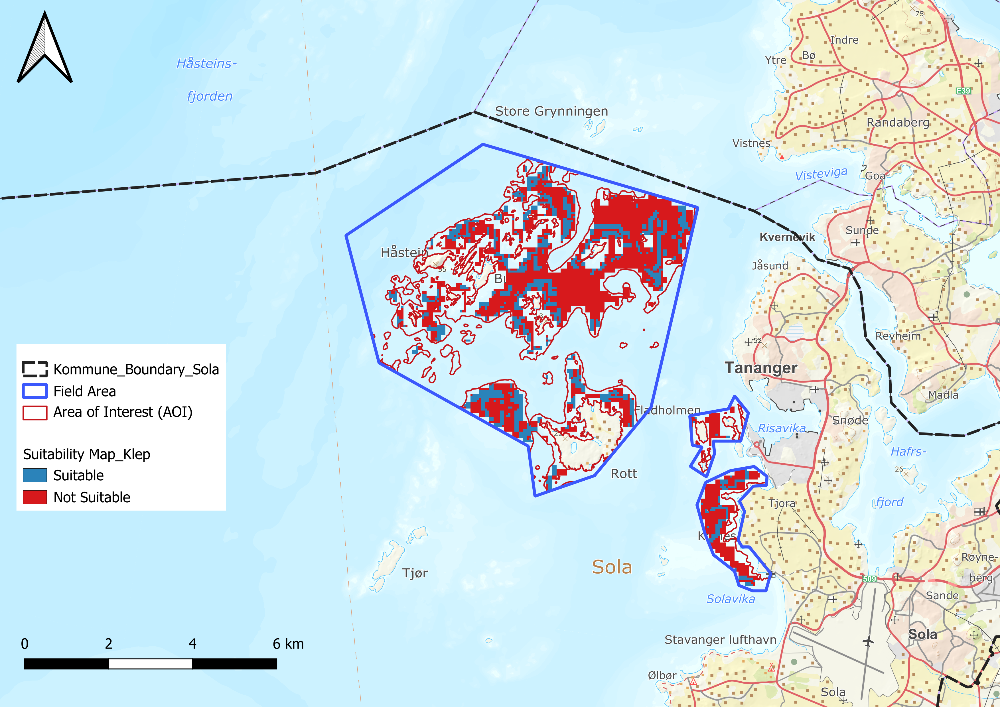
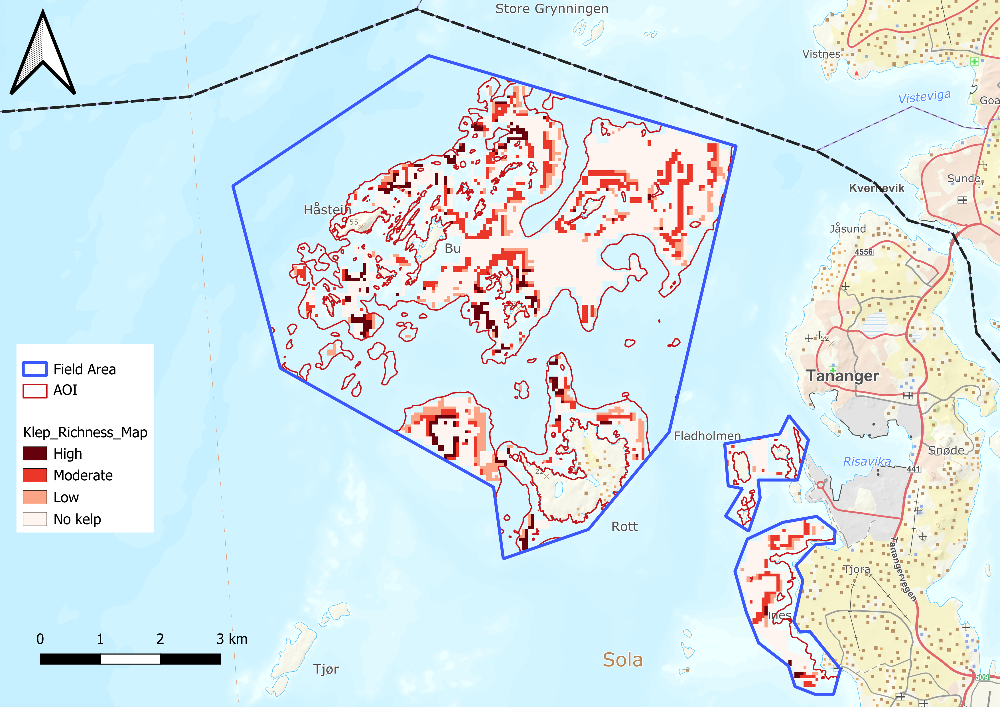
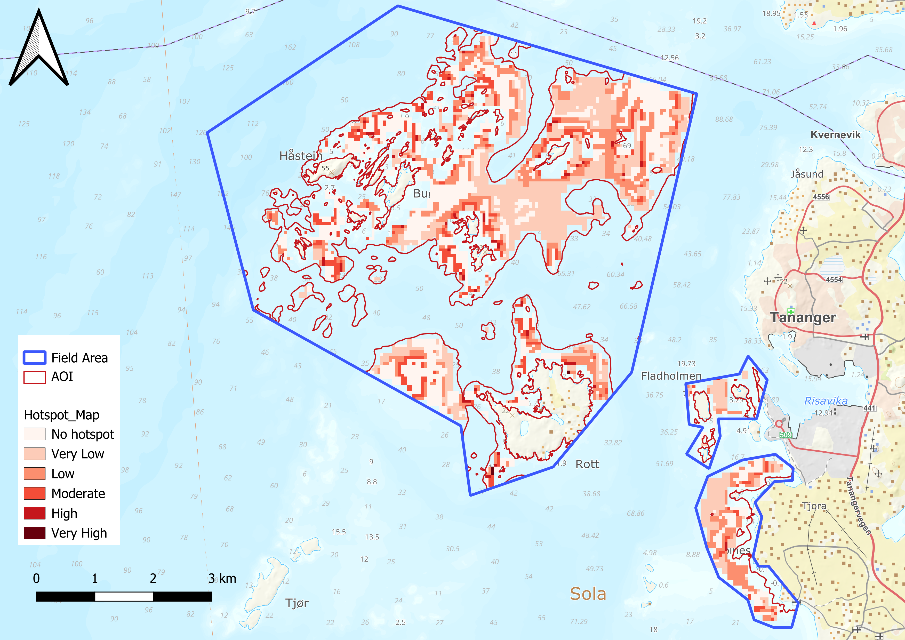
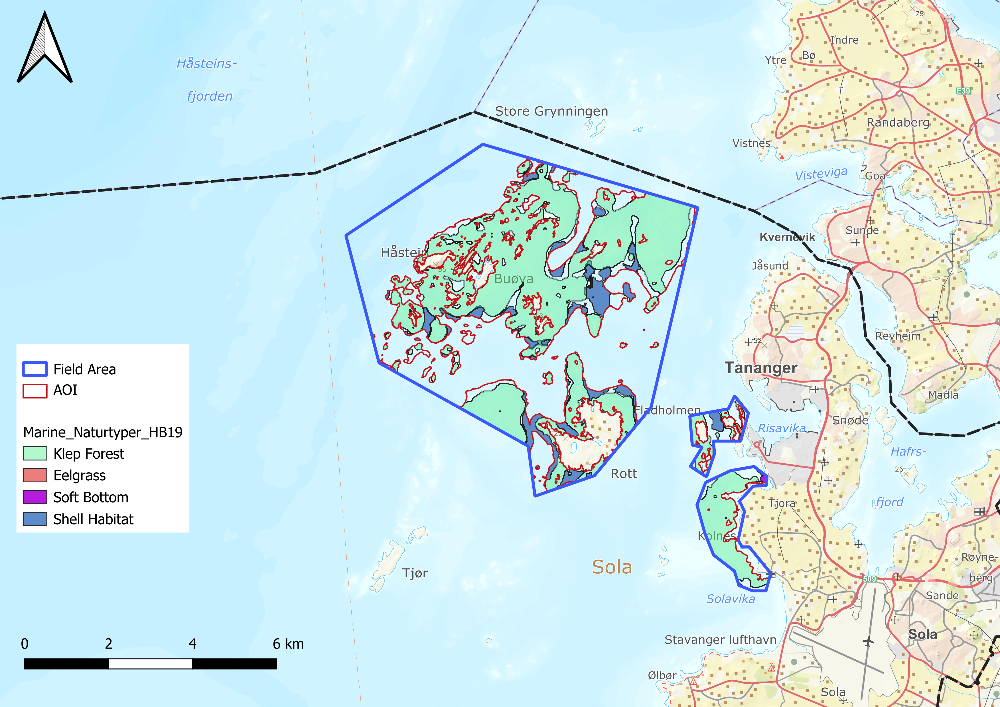
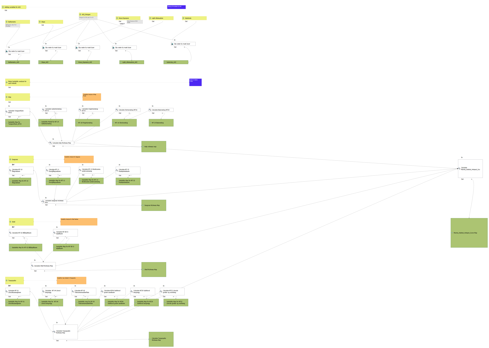

# Marine Habitat Suitability and Hotspot Mapping (NiN 3)

## Project Overview

This project presents a GIS-based workflow for NiN 3 marine habitat suitability modelling, habitat richness mapping, hotspot analysis, and Getis-Ord Gi* spatial statistics for 21 marine nature types in Sola Municipality, Rogaland, Norway.

The study integrates bathymetry, seabed slope, substrate type, wave exposure, and light attenuation to identify potential marine habitats and biodiversity hotspots. Individual habitat suitability maps were combined into richness maps and a final marine habitat hotspot map.

---

## Objectives

- Develop habitat suitability models for 21 marine nature types
- Identify potential habitat-rich areas using richness analysis
- Generate marine habitat hotspot maps
- Apply Getis-Ord Gi* spatial statistics to identify significant hotspot and coldspot clusters
- Compare model outputs with existing HB19 marine nature type datasets
- Automate the workflow using QGIS Model Builder

---

## Study Area

**Sola Municipality, Rogaland, Norway**

Marine study area extending from the shoreline to approximately 30 m water depth.

---


##### Figure: Studay Area (Sola). 


## Environmental Variables

The following environmental datasets were used:

- Bathymetry (Source: EmodNet)
- Seafloor Slope (Derived from Bathemetry)
- Substrate Type (NIVA)
- Wave Exposure (NIVA)
- Light Attenuation (EmodNet)
- Substrate Type (NIVA Substrate Model)
- Wave Exposure (NIVA)
- Light Attenuation (Emodnet)

---

## Habitat Groups
There area 21 nature types according to NiN3 method. For making the analysis simple and organize the habitats divided into 4 major groups.

### Marine Vegetation / Macroalgae (Klep)

### Marine Vegetation / Macroalgae

- NT-03 Tangsamfunn
- NT-14 Sukkertareskog
- NT-16 Stortareskog
- NT-18 Fingertareskog
- NT-20 Butareskog
- NT-21 Ruglbunn

### Seagrass & Coastal Vegetation

- NT-09 Marin tidevannssump
- NT-10 Ålegrasbunn
- NT-11 Dvergålegrasbunn
- NT-13 Brakkvanns-undervannseng
- NT-32 Pusleplantebunn

### Shell Habitats

- NT-02 Blåskjellbunn
- NT-07 Flatøstersbunn
- NT-08 O-skjellbunn

### Topography / Geomorphology

- NT-01 Litoralbassengbunn
- NT-04 Litoral bergvegg
- NT-05 Tidevannsmudderflate
- NT-06 Sublitoral grunn sandbunn
- NT-22 Litorale grotter og overheng
- NT-29 Sublitoral bergvegg
- NT-30 Sterke tidevannsstrømmer

---

## Workflow

```text
Environmental Variables
            ↓
Habitat Suitability Modelling
            ↓
Habitat Richness Mapping
            ↓
Marine Habitat Hotspot Score
            ↓
Getis-Ord Gi* Hotspot Analysis
```

---

## GIS Methods

### 1. Habitat Suitability Modelling

Binary suitability models were developed for each habitat type using environmental thresholds.

Suitability classes:

- 1 = Suitable
- 0 = Unsuitable


##### Figure: Suitability Map for Klep forest.


### 2. Habitat Richness Mapping

Individual habitat suitability maps were combined into group-level richness maps:

- Marine Vegetation Richness
- Coastal Vegetation Richness
- Shell Richness
- Topography Richness


##### Figure: Richness Map for Klep Group


### 3. Hotspot Analysis

The richness maps were combined into a final:

**Marine Habitat Hotspot Score**

which identifies areas with high concentrations of potential marine habitats.



##### Figure: Final Hot Spot Map for Study Area.


### 4. Getis-Ord Gi* Analysis

Raster hotspot scores were converted to points and analyzed using Getis-Ord Gi* statistics to identify:

- Statistically significant hotspots
- Statistically significant coldspots 
- Statistically significant coldspots 


##### Figure: Getis-Ord Gi* Analysis. 

---

## Validation

Model outputs were visually compared with:

- HB19 Marine Nature Types
- Existing habitat datasets
- Known ecological patterns within the study area

This comparison was used to evaluate habitat suitability predictions and hotspot distributions.

<img width="1232" height="560" alt="image" 

##### Figure: Compariron of suitability map for klep with HB_19.


### 5. Bivariate Local Moran's I Validation
 
Bivariate Local Moran's I was used to evaluate the spatial relationship between the Marine Habitat Hotspot Score and HB19 habitat value classes.
 
The analysis classifies locations into four categories:
 
- HH (High-High): high hotspot score associated with high HB19 values
- LL (Low-Low): low hotspot score associated with low HB19 values
- HL (High-Low): high hotspot score associated with low HB19 values
- LH (Low-High): low hotspot score associated with high HB19 values
- Known ecological patterns within the study area 
- HH and LL clusters indicate agreement between model predictions and mapped HB19 habitat values, while HL and LH clusters identify areas where the model and HB19 differ.



##### Figure:  Bivariate Local Moran's I Validation of Marine Habitat Hotspot Scores Against HB19 Habitat Values.

This comparison was used to evaluate habitat suitability predictions and hotspot distributions.

---

## Automation

### QGIS Model Builder

A reusable QGIS Model Builder workflow was developed to automate:

- Raster preprocessing
- Habitat suitability modelling
- Richness calculations
- Hotspot mapping


##### Figure: Work flow with Model Builder. 


### Python

Python scripts were used for raster alignment and preprocessing.

---

## Repository Structure

```text
data/
docs/
images/
maps/
model_builder/
qgis_project/
scripts/
```

---

## Key Outputs

- 21 Habitat Suitability Maps
- Marine Vegetation Richness Map
- Coastal Vegetation Richness Map
- Shell Richness Map
- Topography Richness Map
- Marine Habitat Hotspot Map
- Getis-Ord Gi* Hotspot Analysis
- QGIS Model Builder Workflow

---

## Software

- QGIS
- QGIS Model Builder
- Raster Calculator
- Getis-Ord Gi* Hotspot Analysis Plugin
- Python

---

## Author

**Arjuman Banu**

GIS | Remote Sensing | Habitat Suitability Modelling | Marine Spatial Analysis
